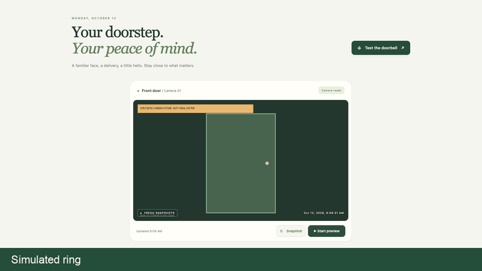
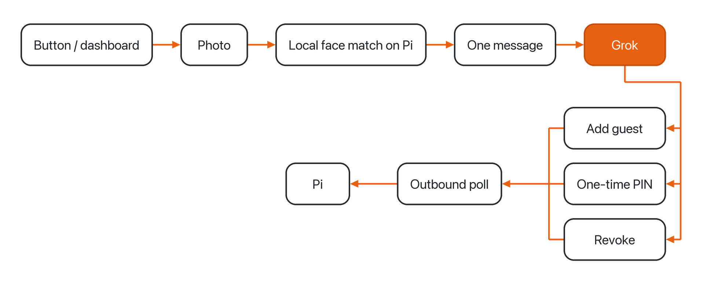

# RingPi



Your doorbell, run by Grok. Local face recognition on a Raspberry Pi 5.

## How a ring moves



Source for that picture: [assets/flow.mmd](assets/flow.mmd).

## Features

- Guest by photo and a time window
- One-time PINs
- Revoke
- Motion alerts
- Quiet hours
- Evening summary

## Local models

These run on the Pi.

- YuNet
- SFace
- SmolVLM-256M
- Qwen 2.5 1.5B Instruct (local text model, llama.cpp)

Weights stay out of git. Install them with `scripts/install-local-models.py` and `scripts/install-local-captions.py` when you want them. Details: [docs/LOCAL_MODELS.md](docs/LOCAL_MODELS.md), [docs/LOCAL_CAPTIONS.md](docs/LOCAL_CAPTIONS.md).

## Parts

- Raspberry Pi 5
- A Pi camera (`rpicam-still` or `libcamera-still`)
- Optional normally-open button on one free BCM GPIO

Leave BCM 8, 10, 11, 17, 24, and 25 unwired. The existing screen-adapter wiring uses them. No pin is chosen for you.

## Quickstart

About 15 minutes. Python 3.11 or newer.

### Checkout

```bash
git clone https://github.com/kaku-san/RingPi.git
cd RingPi
bash scripts/setup.sh
.venv/bin/python -m agent_doorbell
```

Open http://127.0.0.1:8877. Without a camera command, the dashboard shows the camera offline and a ring still saves.

On a Pi, `scripts/setup.sh` forwards to the existing installer. Type the SSH target only in your terminal. Do not commit it.

### Grok Bot routine

Paste [examples/grok-bot-routine.md](examples/grok-bot-routine.md) into the existing doorbell routine. It does not create a webhook, a key, or an account. Save the routine URL on the dashboard. Keep the key in the Pi environment.

### Command queue

[deploy/cloudflare-queue/](deploy/cloudflare-queue/) is the Worker drop spot. Set the secret `QUEUE_KEY` and a KV binding named `Q`. The Pi polls that queue outbound. Leave the queue URL unset until the Worker exists, and do not commit the URL or the key. See [deploy/cloudflare-queue/README.md](deploy/cloudflare-queue/README.md) and [docs/OUTBOUND_COMMANDS.md](docs/OUTBOUND_COMMANDS.md).

`bash scripts/test.sh` runs the local checks.

## Roadmap

- A real lock
- A camera grid
- Muse / Hermes

Grok is a trademark of xAI; not affiliated.

[](LICENSE)
[](https://github.com/kaku-san/RingPi/actions/workflows/test.yml)
