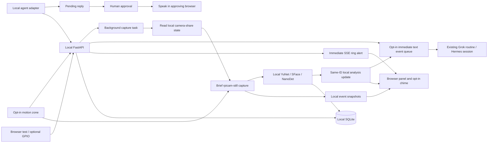

# Architecture

One Python process serves the static browser app and local API on 8877. Use one Uvicorn worker: the in-memory event stream and camera lock are per process. SQLite and event files live outside the checkout under a dedicated data directory.

## Event contract

An event is persisted before camera work starts. It has an immutable ID/time/type/source, capture status, local frame references, detector status, optional manually assigned profile, note, acknowledgement and an explicit simulation flag. Capture errors are data, not a reason to drop a ring.

The `ring` SSE event precedes image work. `event_updated` carries subsequent frames/status. Clients reconcile by event ID and refresh history after reconnect. Streams have bounded queues and heartbeat comments. There is no guarantee of mobile push delivery when the browser is suspended.

Motion is luminance difference in a normalized rectangle, at low resolution. Two successive changed frames and an event cooldown reduce duplicate events. Shadows, lighting and moving foliage can still trigger it. Person detection is a separate optional assessment and never silently suppresses a real ring.

## Privacy and execution boundaries

- No cloud SDK or public image endpoint. Optional Grok image bytes use only the existing authenticated webhook and a reviewed decoder; see [image boundaries](GROK_IMAGES.md).
- No credentials copied from other local apps.
- No display imports, GPIO reconfiguration, writes to other local apps, process stops, or door unlock commands.
- The camera lock protects this application only; camera-share coordination is a read-only, best-effort state check. The camera subprocess is short-lived. Timeout cleanup kills only this application's own subprocess.
- Database/media are local and created with restrictive file modes. Retention and deletion remove both event rows and captures.
- The current HTTP surface assumes a trusted LAN. Authentication, remote access and TLS termination are separate future deployment decisions, not silently provisioned here.

## Extension interfaces

`Camera.capture()` returns a JPEG or a structured busy/offline error. Test fixtures are explicitly labelled. `PersonDetector.detect()` returns detected / not_detected / unavailable; it has no identity or policy authority.

`LocalVision` uses checksum-verified official YuNet/SFace/NanoDet weights. Enrollment is an explicit user-selected upload with consent; embeddings/photos are private and removable. Matching reports probable / unknown / uncertain and image-quality states; thresholds are conservative initial values, not a calibrated identity guarantee. Manual corrections win over late analysis. NanoDet reports bounded positive detections from its canonical COCO vocabulary; the HOG fallback reports pedestrians only. Bot payloads whitelist those labels and generate brief observation text. Missing detections are not absent-object claims. A probable face match is not identity. Arbitrary caption text cannot change identity, tools, or access; the only later use is an unverified text observation on the same event.

All saved burst frames are submitted to a shared local analysis worker: one active call and at most one waiting frame, with burst length bounded to five. Quick frame/observation updates remain asynchronous. Automatic identity is withheld until the burst finishes and all usable face evidence agrees on one profile. Multiple-face/person evidence, disagreement or incomplete analysis vetoes assignment. Event-local frame diagnostics contain no embeddings or names and never enter Bot payloads. Enrollment deletion scrubs prior nested match evidence. The final, deduplicated Bot analysis stage follows burst completion/failure; the initial ring stage still precedes any camera or model work. See [aggregation and queue limits](LOCAL_MODELS.md#recognition-across-the-snapshot-sequence).

Optional scene descriptions use one event image through the existing Grok webhook after separate media consent and owner configuration. The ring text never waits for camera/encoding. Connection revisions captured at ring time prevent later image updates following a changed destination or scope. No alternate model API credentials or public image route are introduced.

`BotService` maintains explicit endpoint/session/destination setup, a bounded persistent queue, frozen retry payloads, setup/credential fingerprints and delivery history. Ring, analysis, and local-caption stages keep the same event ID and have separate deduplication keys. The caption stage is text only, bounded in length and age, labeled as an unverified model observation, and dropped when the event or the pairing captured at ring time is gone. It never waits in front of the ring text. Grok HTTP 200 is accepted/start only; ambiguous sends are never automatically repeated. Hermes uses existing-session runs with remote idempotency, capability/session verification, polling and exact human approvals. Images default off; a separately consented Grok analysis can contain one bounded JPEG from its first frame. Embeddings, enrollment/history media and media URLs never enter Bot payloads. Image jobs receive one POST attempt; terminal records scrub image data. Provider/tool text is inert data and cannot directly execute or speak.

Adapters start disabled. Saving setup is local-only, with no DNS or network probe. A synthetic test and explicit destination confirmation precede enabling. Grok results live in the owning Bot chat; Hermes results live on this dashboard and are not gateway delivery receipts. No custom response tool, public callback or device grant is configured. Dot and Muse remain pending/unsupported. The local context/history API is a trusted-LAN query interface, not an automatically granted remote tool.

## Operational isolation

| Resource | Agent Doorbell |
| --- | --- |
| Source | `~/agent-doorbell` |
| Environment | `~/agent-doorbell/.venv` |
| API/UI | 8877 |
| Data | `~/.local/share/agent-doorbell` |
| User service | `agent-doorbell.service` |
| Config overrides | `~/.config/agent-doorbell/environment` |

Deployment transfers only `git archive HEAD`. It refuses an unmanaged existing directory, keeps host-key verification enabled and uses one user-authenticated SSH session. It does not change firewall, SSH, login/lingering or other local service settings.

## Simulated access workflows

`AccessSimulation` has a separate proposal, temporary visitor, bounded pass, arrival, guest-approval and audit ledger in the private database. The lock boundary is `LockDriver`. This release registers only `SimulationLock`, a memory fixture; `register_lock_driver` refuses every other plugin, and actual hardware remains unknown/unconfigured. An exact command needs explicit mock owner confirmation. A visitor pass needs advance mock owner confirmation once, with a bounded window and one use; the manual arrival fixture then checks its existing approval, visitor match and mocked second factor without requesting another owner decision. A door recognition of a temporary guest is separate: it records evidence only. A probable match does not prove identity. The simulated lock runs only after a later guest-approval decision, and the device label DONE is allowed only when that result is a server-confirmed simulation. Durable request reservations and conditional pass transitions prevent concurrent consumption and replay. Unknown/failed acknowledgments cannot claim physical actuation. Face and caption workers never call the lock.

The `/api/access/simulation/...` routes are local dashboard fixtures with the existing same-origin policy and bounded metadata. They are not an inbound Grok webhook or public command endpoint. Hardware, visitor credentials and live arrival verification remain unconfigured; optional temporary-photo ingestion is described below. See [simulation behavior and unresolved live boundaries](ACCESS_SIMULATION.md). Caption setup is independently staged through `scripts/captions-pi.sh`; it preserves the running app version and transfers no app archive.

## Reviewed temporary enrollment bridge

`EnrollmentBridge` implements a separately enabled proposal/owner scope boundary. The portable local client sends five consented local JPEG/PNG files through existing SSH stdin to a Pi-resident signer, then the existing loopback HTTP service. Signed requests bind scope-specific key, method/path/body, freshness and a durable nonce. The LAN-facing route refuses non-loopback clients; default missing/disabled policy refuses all real ingress before reading its body. Purpose keys stay on the Pi, independently of the Grok notification credential. No cloud attachment-export API, public callback or new SSH/network policy is introduced.

Untrusted bundles are bounded, canonicalized and staged in owner-only `temporary-references` files. An immutable name/window/photo-digest proposal has a five-minute owner-review deadline. Exact owner consent then runs all five local face-quality checks, persists references/embeddings in separate temporary tables and creates one advance-approved simulated pass. Failure, interrupted review, expiry, consumption and revocation remove the reference data; interrupted review also revokes a partial grant. Household profiles and recognition workers have no new grant authority. A minute-level housekeeping worker retries cleanup errors and reports a static health issue. Real hardware remains unavailable even after a bridge policy is enabled.

The hardware-free route accepts only the five server-owned generated images and mock decisions. Real proposals are excluded from that browser list and cannot be approved through fixture routes. The setup helper requires separate owner approval before creating any key; it is not invoked by installation or startup. See [bridge setup/flow/limits](ENROLLMENT_BRIDGE.md) and [portable fork guide](FORK_SETUP.md).

The Pi helper signs each request after receiving the unsigned body over SSH. Separate API signature scopes do not create separate OS identities: the owner SSH account can invoke either signer and normal shell commands. Exact native per-command approval is required for both proposal and owner decisions. A restricted unattended agent identity is not configured or claimed.
