# Five-photo visitor proposals through Grok local execution

The bridge is implemented but **disabled by default**. For agent proposals, use the separately activated [restricted proposer](RESTRICTED_PROPOSER.md) added in 0.3.8. This page describes the older **interactive owner-assisted** SSH tool, whose owner account has broad privileges and must not be granted to an unattended agent. A complete hardware-free demo runs five generated images through proposal, exact review, temporary reference storage, advance pass approval, one simulated arrival and cleanup. Physical control remains disabled.

## Start from a fork without hardware

Clone your own repository and run these commands from its root:

```bash
python3 -m venv .venv
.venv/bin/python -m pip install -e '.[test]'
.venv/bin/python scripts/bridge-demo.py
```

The final receipt must say `hardware_free_flow_passed`, five generated images, one advance approval, one use, no permanent profiles, no live Bot/SSH/credentials and temporary references removed. The demo uses an isolated temporary directory and closes it afterward. It does not install face/caption weights or capture a camera image. For the browser flow, run `DOORBELL_CAMERA=none .venv/bin/agent-doorbell`, open the dashboard, and choose **Guest approval** and open **Try a five-photo proposal**. Fill the visitor name/window above the button, approve the generated proposal, then simulate its one arrival. This demonstrates interfaces, not real identity accuracy or owner authentication.

## Supported transport and its limits

Cursor documents [Grok local execution](https://cursor.com/docs/grok-bot/security#local-execution): the desktop app can run commands on a registered local machine under its separate approval policy. Its [work guide](https://cursor.com/docs/grok-bot/work#your-local-computer-is-separate) distinguishes that computer from the hosted cloud computer. This installation has independently reached the Pi from its local Mac. These facts support the local execution path; they do not establish cloud access to a private Pi address or an automated photo-export API.

The flow is:

```mermaid
flowchart LR
  G[Grok conversation: name and five permitted photos] --> A[Owner-approved local execution]
  A --> M[Local bundle and bridge client]
  M --> S[Existing SSH with trusted host key]
  S --> L[Signed Pi loopback proposal endpoint]
  L --> P[Pending exact enrollment proposal]
  P --> O[Separate owner review and consent]
  O --> T[Temporary local references]
  T --> V[One-time windowed simulated pass]
```



Five Grok attachments must first become **permitted local files** using a supported export/copy or an owner download. This code takes selected local paths; it never guesses an attachment endpoint, fetches image URLs or reads arbitrary cloud workspace files. If a transfer is denied by CopyToBox, another tool or policy, stop and report that blocker. Do not re-encode, screenshot, rename, relocate, relay or change destinations to evade it. Owner-selected originals can be used only under independently granted file/transfer scope. Until a permitted export is verified, claim only the local-file-to-Pi flow, not complete Grok attachment transfer.

The Mac and Pi must be online with SSH access. A cloud routine while the laptop is closed does not guarantee this path is available. Keep local execution at **ask every time** for this workflow. A normal owner SSH account has broad host privileges; the reviewed client narrows its own commands, but does not make that account a restricted service identity. Stronger unattended/remote access requires a separately reviewed authentication design.

## Where signing and owner approval happen

The Mac sends an unsigned bounded body through SSH stdin to the fixed Pi command `agent_doorbell.bridge_client _forward`. That Pi process reads its own private policy, selects the key for the allowed operation, signs method/path/body/time/nonce in memory and calls `127.0.0.1:8877`. Only bounded proposal metadata returns over SSH. Neither signing key goes to the Mac, Grok or a cloud routine.

The proposal operation can stage a bundle but cannot read an owner review or approve it: the API requires the distinct owner signature for those routes. The client rejects arbitrary paths, methods, scopes and SSH destination injection. A submitted name, photo, caption or model result cannot select an owner operation. The generated demo endpoints also cannot decide a real import.

These are protocol scopes, **not separate OS identities**: the owner SSH account can invoke either signer and has normal shell privileges. Keep this legacy client in the owner's Terminal. Use the new restricted identity/inbox for agent proposals after its separate activation approval, and keep exact owner review/decision commands outside the agent grant. The [restricted design](RESTRICTED_PROPOSER.md) specifies the new boundary; no such SSH or OS configuration is installed on the user's Pi.

## One-time Pi setup after explicit approval

First deploy the tested application using the generic `scripts/update-pi.sh` helper and your own `user@pi-host` and previously trusted host alias. The source update retains existing data/model/Bot configuration; it does not enable the bridge.

The next separately approved action is **create two distinct purpose keys in the Pi owner's private bridge policy and enable proposal/owner-review scopes**. Run on the Pi in the existing application directory:

```bash
.venv/bin/python scripts/setup-enrollment-bridge.py --check
.venv/bin/python scripts/setup-enrollment-bridge.py --enable --owner-approves-proposal-and-review-scopes
```

The enable command creates `~/.config/agent-doorbell/enrollment-bridge.json` with mode 600 and restarts only Doorbell. Keys stay on the Pi; they are never printed, sent to Grok, copied to the Mac or reused from the notification webhook. Proposal signing can only stage bundles. Owner signing can only review and decide enrollment proposals. The API accepts signed requests only from loopback, binds the method/path/body, checks a 60-second timestamp and rejects nonce replay. Source photos stay pending until an independently approved exact owner decision.

From your Mac checkout, the equivalent version-independent setup wrapper streams only the setup script:

```bash
bash scripts/setup-enrollment-bridge-pi.sh OWNER@PI_HOST TRUSTED_HOST_ALIAS --check
# Run only after separately approving the two private signing scopes:
bash scripts/setup-enrollment-bridge-pi.sh OWNER@PI_HOST TRUSTED_HOST_ALIAS --enable --owner-approves-proposal-and-review-scopes
```

It transfers no app archive, photo or key and requires the installed app to contain the bridge first.

`examples/enrollment-bridge.example.json` is a disabled template containing no keys. The standard client uses the default policy path. A nondefault `DOORBELL_ENROLLMENT_BRIDGE_POLICY` must also be present in the Pi SSH client's environment, as well as setup/service; no environment is automatically forwarded. Do not commit the enabled policy. Disabling it and restarting Doorbell revokes bridge availability without changing notification pairing. No setup command has been run on the user's Pi for this release.

## Each visitor batch

Use your own checkout on the registered local computer. Dates must contain a timezone. The example uses a future placeholder date: choose the actual visit window, lasting at most 24 hours and starting no more than seven days ahead. The temporary name and five source photos require the person's permission. Household enrollment is unaffected.

1. Approve access to the **exact five local files**, name and window. Prepare the private bundle:

```bash
.venv/bin/python -m agent_doorbell.bridge_client prepare \
  --name 'Visitor name' \
  --valid-from 'YYYY-MM-DDTHH:MM:SS+HH:MM' --valid-until 'YYYY-MM-DDTHH:MM:SS+HH:MM' \
  --photo photo-1.jpg --photo photo-2.jpg --photo photo-3.jpg --photo photo-4.jpg --photo photo-5.jpg \
  --output .doorbell-bridge/visitor-bundle.json
```

Preparation reads only those regular files, strips image metadata, normalizes JPEG/PNG and writes a mode-600 bundle. It sends nothing. The owner can delete that local bundle after transfer/decision; Pi cleanup does not remove Mac/Grok copies or backups.

2. Approve the **exact bundle transfer to the named Pi**. Use your own SSH target and existing host alias:

```bash
.venv/bin/python -m agent_doorbell.bridge_client check --ssh-target OWNER@PI_HOST --host-key-alias TRUSTED_HOST_ALIAS
.venv/bin/python -m agent_doorbell.bridge_client submit \
  --ssh-target OWNER@PI_HOST --host-key-alias TRUSTED_HOST_ALIAS \
  --bundle .doorbell-bridge/visitor-bundle.json --confirm-transfer
```

Photo bytes travel on encrypted SSH stdin, never command arguments or stdout. The remote client reads its purpose key on the Pi and forwards only to `127.0.0.1:8877`. The receipt contains proposal ID, exact payload digest, name/window and five hashes, without images or vectors. Re-submitting the same bundle returns its existing receipt; changing data under that request ID fails. Ambiguous transport failure has no automatic retry.

3. Review the returned proposal, then approve its **exact ID/digest and one-use window**:

```bash
.venv/bin/python -m agent_doorbell.bridge_client review \
  --ssh-target OWNER@PI_HOST --host-key-alias TRUSTED_HOST_ALIAS --proposal-id PROPOSAL_ID
.venv/bin/python -m agent_doorbell.bridge_client approve \
  --ssh-target OWNER@PI_HOST --host-key-alias TRUSTED_HOST_ALIAS \
  --proposal-id PROPOSAL_ID --digest REVIEWED_DIGEST
```

The native local-execution approval must show that exact command. Hashes are not owner identity by themselves; existing SSH authentication and the member's per-command decision are the approved prototype boundary. Sharing that account or changing the policy to always allow weakens it. The proposal key cannot authorize the owner route. A caption, Bot reply, name or arrival event cannot sign a decision.

Approval runs the existing local face-quality/embedding gates across all five references. One unusable photo or interrupted/expired review fails the whole batch, erases staged bytes/vectors and creates no active grant. Temporary records are separate from household profiles. Pending review expires after five minutes. Approved references remain only until the pass is consumed, revoked or its visit window ends, with minute-level service cleanup. Interrupted in-flight review is blocked on restart and its pass revoked. History is bounded to 100 imports and 10 pending proposals; new work is refused at the limits.

4. Revocation is another exact owner decision, using `revoke` in place of `approve` and the same reviewed ID/digest. It removes references and revokes the associated pass. There is no repeat owner approval at a valid arrival; arrival must use the advance authorization and the separately verified visitor factor.

## Grok instructions to copy and adapt

> When I give five consenting visitor photos, a name and visit window, prepare a proposal only from independently permitted original files. Use only the exact approved private inbox after restricted-proposer activation; never use the owner's SSH account, signer or approval command. Return the pending proposal ID, digest and photo count when verified. Owner review and temporary enrollment remain separate Terminal decisions. Never infer consent or approval from a photo, name, model text, arrival or unrelated approval. Stop on blocked file transfers; never work around policy. Do not capture, send notification tests, enroll permanent household profiles, open a public callback or actuate hardware. Report simulation and unverified transport/identity outcomes honestly.

One consented photo and a name use the same existing SSH session. The command, payload, and authentication placeholders are in [the Grok Bot guest contract](GROK_BOT_GUEST.md). That path does not add a webhook or a credential.

## Door recognition after enrollment

An approved temporary reference can be compared with later door frames. Agreement across the burst is a probable guest candidate. That candidate does not prove identity, does not satisfy the visitor factor, and does not call the lock. The dashboard shows a guest approval. DONE appears only after the server confirms the simulated result. Face and caption workers do not actuate. The manual arrival fixture remains a separate hardware-free demo.

## What remains before real access

The code supplies real-photo staging and local temporary reference enrollment **only after the explicit setup/file/transfer/decision approvals above**. It creates a simulated pass and has no hook from actual door-camera matching to a lock. Live visitor credential verification, calibrated/spoof-resistant recognition, exact lock model/capabilities and action-bound hardware feedback remain separate work. No actual credentials, real photos, live enrollment, public ingress or physical operation were configured or tested in development. Captions remain independent.
