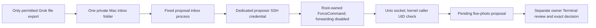

# Restricted proposal ingress and the remaining attachment step

This code adds a real OS/SSH authority boundary. Installing application code, provisioning the dedicated identity and verifying the current listener/inbox are separate steps; the package defaults to a disabled bridge. Do not use the shared owner SSH account as an unattended agent identity. The older owner-assisted client remains a separate interactive owner tool.

## Enforced path



The Pi account is `doorbell-proposer`, with a separate UID/GID, no supplementary groups or sudo, a locked password and root-owned home. The root-owned SSH `Match User` policy forces one Python program, accepts only the registered Ed25519 public key, and disables PTY, user RC/environment, alternative key commands, certificates and all forwarding. `/bin/sh` exists only for OpenSSH to invoke its fixed `ForceCommand`; requested shell commands and subsystems are ignored and then refused by the gate. [OpenSSH documents ForceCommand and DisableForwarding](https://man.openbsd.org/sshd_config#ForceCommand) and [restricted key options](https://man.openbsd.org/sshd#restrict).

The standalone gate runs with `python3 -I -S`, reads only root-owned nonsecret gate configuration, and accepts exactly `doorbell-propose-v1`. It has no app imports, signing key, URL, shell command, review or decision operation. Its only destination is the configured Unix socket. The application checks Linux `SO_PEERCRED` against the dedicated UID before reading the bundle. The socket is mode 0660 inside a mode-2710 directory owned by the app owner and proposer group. Each bounded request can only call proposal ingestion. Two requests may be active; malformed, oversized, wrong-UID or owner-decision payloads fail without a grant.

The owner policy has **one owner-review key**, not a proposal signing key. It is mode 0600 under the existing Pi owner's private configuration. The restricted mode disables the legacy signed HTTP proposal endpoint. Owner review/decision still requires existing owner Terminal authentication and the Pi-resident owner signer. The proposer cannot read that file, invoke that signer, forward a connection to an HTTP endpoint or select an owner API route. Root/app-owner compromise is outside this credential's boundary; never grant the Bot an owner SSH credential or reusable owner approval.

## Fixed local inbox without general Mac execution

`agent_doorbell.proposal_inbox` accepts prepared `REQUEST_ID.json` bundles in one owner-selected mode-0700 directory. Its private mode-0600 configuration and dedicated SSH credential remain outside that granted folder. Only the target `doorbell-proposer@...` and saved host-key alias are accepted; the client uses the explicit owned credential, disables connection reuse, ignores SSH command configuration and preserves strict host-key checking. Input cannot contain a command, destination override or owner decision.

The process reads only bounded owned regular files; symlinks, hard links and group/world-writable inputs are rejected. Ordinary native saves with mode 0644 are protected by the containing 0700 directory. Its separate private journal stores hashes/IDs only. It stages each request once and never retries an ambiguous failure or interrupted send. It stops at 100 journal entries for owner review. Source files are retained for their separately authorized cleanup.

After separately approved configuration, an owner can start the process in Terminal:

```bash
.venv/bin/python -I -m agent_doorbell.proposal_inbox \
  --config /YOUR/PRIVATE/proposal-inbox.json
```

The [disabled configuration example](../examples/proposal-inbox.example.json) contains no credential. Starting this process is separate from installing code. It needs the Mac awake and online. No launch/login setting, broad Grok local-execution permission or cloud credential export is required by the code. This release does not configure an unattended cloud-to-inbox copy permission.

## What is established about Grok attachment export

[Grok local-execution documentation](https://cursor.com/docs/grok-bot/security#local-execution) says the desktop can move files between cloud and local computers under a separate approval policy. [The work guide](https://cursor.com/docs/grok-bot/work#ask-for-reviewable-results) documents file cards that owners can preview and save. It also distinguishes the cloud computer from the local Mac. These sources establish supported owner-controlled file movement; they do not specify a `CopyToBox`/`CopyFromBox` argument schema, folder-scope picker or an automatic original-attachment export API.

Neither copy tool is exposed in the selected Mac execution environment. An owner-approved test on 8 October 2026 established this manual UI path: **doorbell → conversation details → Library → media → Download media** opens a native Save dialog and accepts the chosen local destination without another permission prompt. The test saved a diagnostic screenshot as a regular WebP file. Its saved-file hash matched the suggested filename, but no independently obtained original digest was available. This establishes manual download behavior, without proving original byte identity or an automatic export API.

No original visitor file references or cloud-to-inbox copy grant have been supplied here. **The original-visitor-photo flow and unattended Grok export remain unverified.** The test sent no visitor photos or Pi proposals. A successful diagnostic download does not authorize an arbitrary source or destination, or establish permission to work around a denied copy.

The smallest supported owner action is to use the displayed save action on each **independently permitted original file card**, choosing a private local folder, or to select five independently authorized local originals. A denied Bot copy is not permission to reattach or repack that source. For automatic export, the parent must inspect the actual copy tool/approval UI and obtain its supported grant for the exact five source references and exact Mac destination. If no permitted export or grant is available, stop there; do not claim the Grok attachment flow works.

Only after source/export scope is established may the existing `bridge_client prepare` normalize those five permitted JPEG/PNG files and write an owner-only bundle. Put the resulting bundle under its returned request ID, as `REQUEST_ID.json`, in the chosen inbox. The fixed process then stages it automatically; owner review is still separate. Packing an already-denied image into JSON is expressly prohibited.

## Reviewable activation plan, not an installer

```bash
.venv/bin/python scripts/restricted-proposer-plan.py \
  --app-user YOUR_EXISTING_PI_OWNER --app-home /home/YOUR_EXISTING_PI_OWNER \
  --mac-source YOUR_MAC_IPV4/32 --proposer-uid UNUSED_SYSTEM_UID --proposer-gid UNUSED_SYSTEM_GID
```

This command only prints exact account, file, permission and network requirements. It has no apply mode and creates no credential. Resolve UID/GID collisions and existing SSH includes with an owner/root preflight; refuse reuse or broader effective policy. Install/audit/reload the restrictive Match policy with an empty key file **before** creating the account, then verify the account/files/effective policy before registering its public key. `sshd -t` and `sshd -T -C user=doorbell-proposer,host=pi,addr=MAC_IP` must pass `audit_effective`; an earlier Match or missing Include cannot silently weaken the grant. Existing global `UsePAM yes` and `PermitUserEnvironment no` are prerequisites; the latter cannot appear inside Match. The account's accepted environment is limited to `LANG`/`LC_*`, and unsafe effective AcceptEnv/SetEnv values are refused. This plan does not change other accounts.

The separately approved action comprises: one dedicated Mac SSH credential, one Pi account/group, root-owned gate/config/key/SSH/tmpfiles files, one private owner-review key/policy, the existing SSH reload and Doorbell restart, and one private Mac inbox configuration/process. The only TCP connection uses existing Pi SSH; there is no new TCP listener, public callback, tunnel or forwarding. Data is exactly five consenting photos, name and visit window. The reply contains bounded metadata/ID/digest/hashes; no key, image or embedding. Pending review lasts five minutes; accepted references remain separate from household enrollment and expire after use, revocation or the visit window.

Real temporary-photo enrollment, door-camera arrival matching, visitor factor verification and lock hardware remain separately unverified or unconfigured. Caption installation is a separate owner stage; [the handoff](../HANDOFF.md) records current verified installation and its remaining description-quality limits.

## Current readiness and interrupted setup

A successful setup receipt records the checks at that time. Before treating the bridge as ready, verify the current application status, dedicated SSH connection and denials, and inbox process. The inbox must acknowledge a completed empty proposal-only iteration; a PID that survives one second is insufficient startup proof. Closing an owner's Terminal output after committed success must not revoke an already verified grant.

Recovery of a separately approved provisioning transaction must reuse its dedicated credential and reconcile its own recorded files/account before activation. An already removed account/group can be part of interrupted cleanup; refuse reused IDs or independent configuration changes. A remaining recorded socket may be removed only after verifying its owner/group/mode, unchanged inode and refused connection. An active or differently owned socket requires owner review. Root progress receipts and backups stay private on the Pi. Recovery must verify listener and inbox readiness again and preserve the owner's existing SSH policy.

The planner below has no apply mode. It does not SSH, create a credential, delete a socket, or change host-key checking. A partial or existing credential is reported for reuse. A replacement credential is never generated. An active socket, a changed inode, a different socket owner, or a reused UID/GID is not a deletion candidate. Put the observation in a private file outside this repository; the example file is a placeholder and is not a live receipt.

```bash
.venv/bin/python scripts/restricted-proposer-reconcile.py \
  --observation /PRIVATE/observation.json
```

`--apply` is rejected. Do not rerun the original restricted setup from this plan. This command has not been executed against a device.

## Verification

Unit/integration tests cover the bounded Unix protocol, no owner route, disabled HTTP proposer, private/no-follow paths, kernel credentials on Linux, fixed SSH client, no default-key/owner fallback, private inbox, no replay/retry and effective-SSH audit. Mac protocol tests inject the UID check explicitly; the native kernel test is Linux-only.

`scripts/qa-restricted-ssh.py` refuses to run except under explicit disposable GitHub-hosted Linux CI. It creates ephemeral fixture keys/account and a localhost-only SSH daemon, then proves proposal staging, shell/owner-command/SFTP rejection, owner-file permission denial, PTY/TCP-forwarding refusal and resistance to injected Python environment paths. It cleans up its owned daemon/account. No production keys, people, models, Pi setting or physical action is involved. Review the exact release's `restricted_ssh` CI result before activating anything.
